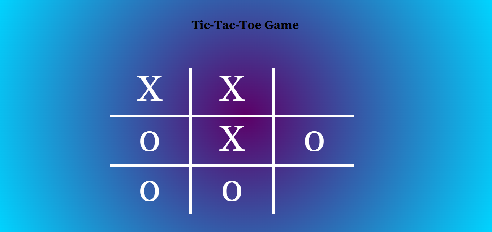

# # Tic-Tac-Toe Game Logic Explanation

This repository contains the core JavaScript logic for a browser-based **Tic-Tac-Toe** game. The script manages user turns, detects winning combinations, updates the visual interface, handles game draws, and resets the board.

---

## ## Global Variables

```javascript
let count = 0;

```

* **Purpose:** Tracks the total number of moves made in the game.
* **Why it's there:** Tic-Tac-Toe has a maximum of 9 moves. This variable acts as the game's clock, deciding whose turn it is (Even numbers = `0`, Odd numbers = `X`) and determining if the match ends in a draw.

---

## ## Core Functions & Logic Breakdown

### ### 1. Turn Management and Gameplay: `myFun(data)`

This is the central coordinator function. It triggers every time a player clicks a cell on the grid.

* **`if (count <= 9)`**: Ensures moves are only processed if the board isn't already completely full.
* **Turn Determination (`count % 2 == 0`)**:
* Uses the modulo operator to see if `count` is even.
* If even, it places a **"0"** in the clicked box.
* If odd, it places an **"X"**.


* **`count++;`**: Increments the turn tracker immediately after a mark is placed.
* **Winner Identification:**
```javascript
let winner = (count % 2 == 1) ? "O" : "X";

```


Because `count++` increments the count *before* this check, the logic uses a ternary operator to reverse-check who just made the winning move. If the new count is odd, the winning move was made on an even count (**"O"**), and vice-versa.
* **`setTimeout(...)`**: Delays the `alert` pop-up and the board reset by **4 seconds (4000ms)**. This allows the player to actually see their winning move and enjoy the background animation (`winnerBackground()`) before the board clears.
* **`else { alert("Math Draw"); ... }`**: If `count` exceeds 9 without a winner triggering, the game declares a draw and triggers a reset.

---

### ### 2. Win Validation: `win()` & `check()`

These two functions work together to scan the board for 3-in-a-row matches.

```javascript
function win() {
    if(check("div1", "div2", "div3") || check("div1", "div4", "div7") || ...) {
        return true;
    }
}

```

* **Why it's structured this way:** Instead of writing massive, repetitive conditional checks, `win()` acts as a map of all **8 possible winning combinations** on a standard 3x3 grid (3 horizontal, 3 vertical, 2 diagonal). It passes these element IDs to the `check()` helper function using logical OR (`||`) operators.

```javascript
function check(div1, div2, div3) {
    if(getData(div1) != "" && getData(div2) != "" && getData(div3)!= "" && getData(div1) == getData(div2) && getData(div2) == getData(div3)) {
        return true;
    }
}

```

* **Why the exact conditions matter:** 1.  `getData(div1) != ""` ensures it ignores empty cells (otherwise, three empty boxes in a row would register as a victory).
2.  `getData(div1) == getData(div2) && getData(div2) == getData(div3)` verifies that all three cells contain the exact same symbol (either all "X"s or all "0"s).

---

### ### 3. Data Retrieval: `getData(div1)`

```javascript
function getData(div1) {
    return document.getElementById(div1).innerHTML;
}

```

* **Purpose:** A clean abstraction helper function. Instead of writing `document.getElementById(...).innerHTML` dozens of times inside the validation code, this function reads and returns the text content of any given cell ID instantly, keeping the rest of the file highly readable.

---

### ### 4. UI/UX Style Alternators: `winnerBackground()` & `defaultBackground()`

These functions manipulate the CSS of the page to give visual feedback depending on the game state.

```javascript
function winnerBackground () {
    document.body.classList.add("winner-BG")
}

function defaultBackground() {
    document.body.classList.remove("winner-BG")
}

```

* **Why it's modern practice:** Rather than writing inline styling styles direct into JavaScript (which is commented out in your source code), these functions cleanly add and remove a pre-defined CSS class (`winner-BG`). This keeps your styling concerns separated cleanly into your CSS files.

---

### ### 5. State Resetting: `reset()`

```javascript
function reset() {
    count = 0;
    for (let i = 1; i <= 9; i++) {
        document.getElementById(`div${i}`).innerHTML = "";
    }
}

```

* **Why it resets this way:** 1. It sets `count = 0` so the next game starts fresh with player "0".
2. It utilizes a **`for` loop** combined with JavaScript template literals (``div${i}``) to sequentially target all IDs from `div1` to `div9`, wiping their inner HTML clean in just three lines of code.

---

## ## Execution Workflow Summary

1. **Click Event:** Player triggers `myFun(data)`.
2. **UI Update:** "X" or "0" is drawn based on the `count` state.
3. **Evaluation:** `win()` checks all 8 grid vectors utilizing `check()` and `getData()`.
4. **Outcome A (Win):** Background changes $\rightarrow$ 4-second delay $\rightarrow$ Success Alert $\rightarrow$ Grid Wiped $\rightarrow$ Background Reverts.
5. **Outcome B (Draw):** If turns reach limit without a win flag $\rightarrow$ Draw Alert $\rightarrow$ Grid Wiped.


### Image Here 👩‍💻

